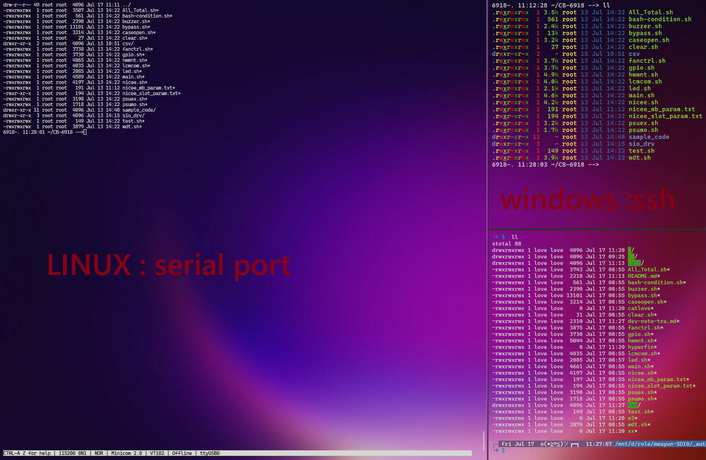
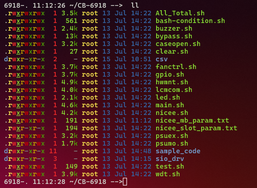
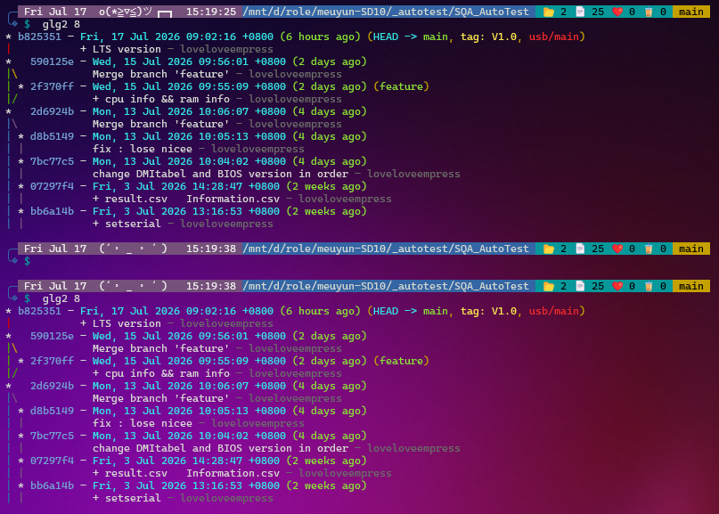
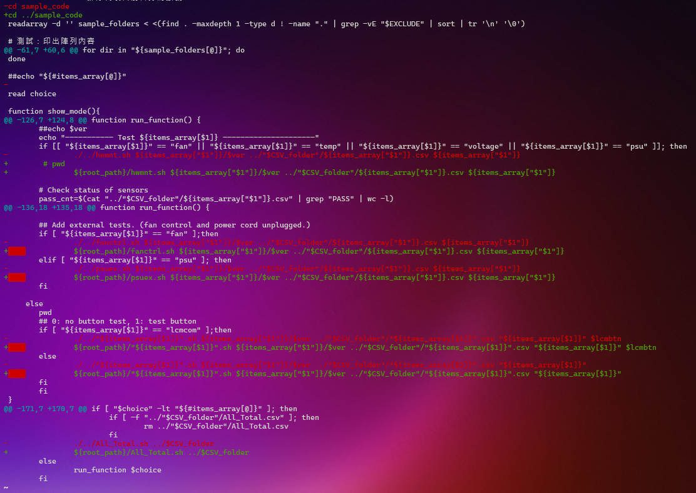

author	: lovequeen
date	:
Fri Jul 17 11:19:48 CST 2026 (2026/07/17-11:19:48)

-------------------------------------------------------------------------------

# env
怕到時候讀者們看不懂
先大致說明 筆者如何使用這些TEST

每一台機器不同
有大有小 如果是小台機器(不吵的)
就會放到筆者會喜歡的環境來TEST

筆者有兩台電腦
通常LINUX是 開發中心
WINDOWS 聯絡 等 使用GUI就偏向 這裡

### env-summary
+ LINUX
  + 開發中心
+ WINDOWS
  + TEAMS
  + GUI

-------------------------------------------------------------------------------


```bash ==== TODO : delete or remain =========================================
+-------+---------+------+
| LINUX |         |      |
+-------+---------+------+
+-------+---------+------+
|       | WINDWOS |      |
+-------+---------+------+
+-------+---------+------+
|       |         | TEST |
+-------+---------+------+
```

# 1.introduction
如果是要TEST的 場景就會是

```bash ================================================================
6918-. 11:12:26 ~/CB-6918 -->  ll
.rwxrwxrwx  1 3.5k root 13 Jul 14:22 All_Total.sh
.rwxrwxrwx  1  561 root 13 Jul 14:22 bash-condition.sh
.rwxrwxrwx  1 2.4k root 13 Jul 14:22 buzzer.sh
.rwxrwxrwx  1  13k root 13 Jul 14:22 bypass.sh
.rwxrwxrwx  1 3.2k root 13 Jul 14:22 caseopen.sh
.rwxrwxrwx  1   27 root 13 Jul 14:22 clear.sh
drwxr-xr-x  2    - root 15 Jul 10:51 csv
.rwxrwxrwx  1 3.7k root 13 Jul 14:22 fanctrl.sh
.rwxrwxrwx  1 3.7k root 13 Jul 14:22 gpio.sh
.rwxrwxrwx  1 4.9k root 13 Jul 14:22 hwmnt.sh
.rwxrwxrwx  1 4.0k root 13 Jul 14:22 lcmcom.sh
.rwxrwxrwx  1 2.1k root 13 Jul 14:22 led.sh
.rwxrwxrwx  1 4.6k root 13 Jul 14:22 main.sh
.rwxrwxrwx  1 4.2k root 13 Jul 14:22 nicee.sh
.rwxrwxrwx  1  191 root 13 Jul 11:12 nicee_mb_param.txt
.rwxr-xr-x  1  194 root 13 Jul 14:22 nicee_slot_param.txt
.rwxrwxrwx  1 3.2k root 13 Jul 14:22 psuex.sh
.rwxrwxrwx  1 1.7k root 13 Jul 14:22 psumo.sh
drwxr-xr-x 11    - root 13 Jul 14:48 sample_code
drwxr-xr-x  3    - root 13 Jul 14:15 sio_drv
.rwxrwxrwx  1  149 root 13 Jul 14:22 test.sh
.rwxrwxrwx  1 3.9k root 13 Jul 14:22 wdt.sh
```
如同

不覺得太亂了嗎? 所以筆者就思考後 決定來改版

畢竟在這裡筆者很常使用 LINUX

一開始也不知道會改多久 就想說慢慢改

(因為有GIT後 真的修改CODE太簡單了...)

這裡開發我都會留下來 只會把我大概的思路

接手後 (好想筆者很愛玩LINUX)

> 畢竟是接手 所以 當然會依照 原本的CODE 來改寫喔

# goal

這裡是筆者接手後 大改版的紀錄

最主要目標是
```bash ======================================================================
.
├── All_Total.sh
├── bash-condition.sh
├── buzzer.sh
├── bypass.sh
├── caseopen.sh
├── clear.sh
├── csv
├── csv_dr
├── csv_user
├── fanctrl.sh
├── gpio.sh
├── hwmnt.sh
├── lcmcom.sh
├── led.sh
├── main.sh
├── nicee.sh
├── nicee_mb_param.txt
├── nicee_slot_param.txt
├── psuex.sh
├── psumo.sh
├── sample_code
├── sio_drv
├── test.sh
└── wdt.sh

#### |   |
#### | t |
#### | o |
#### |   |
#### |   |
#### \   /
####  \ /
####   V

.
├── ccauto  (dev folder)
├── csv     (result folder)
├── sample_code
└── sio_drv
```

後來筆者就發現 當時開發者的寫法

很像C

剛接手到的時候 就大致判斷出

不過在 DEBUG的 時候

SHELL SCRIPT 不像C可以完美追蹤

他只能追第一層

~~如果有時間 筆者在寫~~

就像是這樣

```bash ================================================================
11. voltage
+ items_array[$menu_idx]=voltage
+ menu_idx=12
+ for dir in "${sample_folders[@]}"
++ echo ./wdt
++ cut -d/ -f 2
+ name=wdt
+ echo '12. wdt'
```

好的 那把焦點拉近後

發現當初開發者 與他們互相丟入的參數後

就可以改寫

發現變數乘載的東西

就可以 加入一些 就完成了

前面有說 很像C 其他的都是他的分支

所以理論上只要改主要的 `main`就好了

因為成功改架構了

因為直接改完了

筆者就用GIT 大致說明



筆者還特地用一個 TAG
這是從 別人的網路上的其他好玩的開原專案
學到的

```bash ================================================================
## Add external tests. (fan control and power cord unplugged.)
if [ "${items_array[$1]}" == "fan" ];then
-      ./../fanctrl.sh ${items_array["$1"]}/$ver ../"$CSV_folder"/${items_array["$1"]}.csv ${items_array["$1"]}
+      ${root_path}/fanctrl.sh ${items_array["$1"]}/$ver ../"$CSV_folder"/${items_array["$1"]}.csv ${items_array["$1"]}
elif [ "${items_array[$1]}" == "psu" ]; then
-      ./../psuex.sh ${items_array["$1"]}/$ver ../"$CSV_folder"/${items_array["$1"]}.csv ${items_array["$1"]}
+      ${root_path}/psuex.sh ${items_array["$1"]}/$ver ../"$CSV_folder"/${items_array["$1"]}.csv ${items_array["$1"]}
fi
```
這裡只拿部分來說明
其他的都有在紀錄中

這裡筆者就用 一個位置的方式來改變


